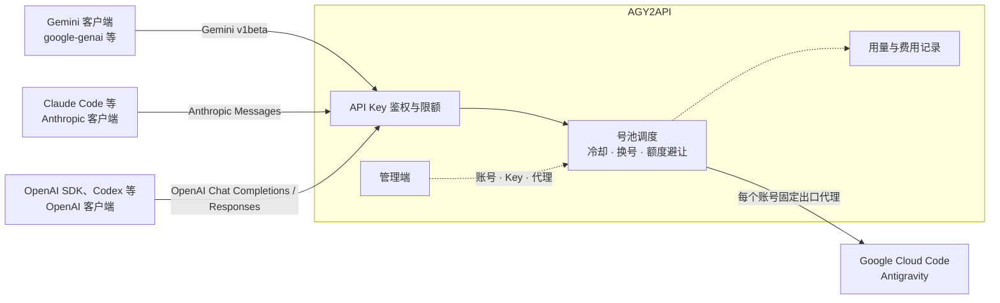

<p align="center">
  <picture>
    <source media="(prefers-color-scheme: dark)" srcset="docs/assets/logo-dark.svg">
    
  </picture>
</p>

<h1 align="center">AGY2API</h1>

<p align="center"><strong>把 Antigravity 账号池变成可调度、可观测的 Gemini、Anthropic、OpenAI 兼容 API 网关</strong></p>

<p align="center">
  <a href="https://github.com/shiceai/agy2api/releases/latest"></a>
  <a href="https://github.com/shiceai/agy2api/actions/workflows/ci.yml"></a>
  <a href="LICENSE"></a>
  
  
  <a href="https://github.com/shiceai/agy2api/pkgs/container/agy2api"></a>
  
</p>

<p align="center"><a href="https://agy2api.pages.dev"><strong>在线演示</strong></a>（口令 <code>demo</code>，数据是模拟的）</p>

<p align="center">简体中文 | <a href="README_EN.md">English</a></p>

管理多个 Antigravity 账号，负责选号、冷却恢复、失败换号和额度避让，对外提供 Gemini 原生 `v1beta`、Anthropic Messages、OpenAI Chat Completions 和 Responses 接口（Claude Code、Codex、OpenAI SDK 等可直接接入），自带管理端。

> **风险提示**：本项目经 Antigravity 账号访问 Google Cloud Code 的内部接口，这种用法可能违反 Google 的服务条款，
> 账号可能被限制或封禁，已付费的订阅不会因此退款。仅供学习和技术研究，风险自负。

## 功能

- **Gemini 原生接口**：`generateContent`、`streamGenerateContent`、`countTokens` 和模型列表，可直接用 `google-genai` 等 SDK；生图模型原样返回图片，可多轮改图
- **Anthropic 接口**：`/v1/messages`（流式和非流式）和 `count_tokens`，Claude Code 等客户端可以直接接入；官方模型名按模型别名映射到号池里的模型
- **OpenAI 接口**：`/v1/chat/completions`、`/v1/responses`（都支持流式）和模型列表，支持工具调用、图片、思考内容和结构化输出，OpenAI SDK、Cherry Studio、Codex 等客户端可以直接接入
- **号池调度**：轮询、智能打分或重置优先选号，按账号和模型冷却，失败自动换号，额度低的账号避让，同一对话优先用同一账号
  （认 Claude Code、Codex 的会话和 `X-Session-Id`，原账号短暂接不了时临时借号、不改绑），每个账号有并发上限
- **账号管理**：Google 登录添加或批量导入，令牌自动刷新，失效自动停用，可单独检测；显示各模型的额度，可选拉取每周额度
- **降低风控**：请求默认注入官方客户端的基础系统提示词、按核验过的官方构建声明客户端版本（随官方发布自动跟进，无需升级网关），让上游更像在和官方客户端对话；上游按系统提示拦截 Claude Code、Codex 时自动把 system 降为用户消息；可选新号预热（逐步放量）和请求节奏（隔开同一账号的请求）；可选封禁保护：有账号被条款封禁后整个号池暂停一段时间
- **出口代理**：每个账号绑定固定的出口代理（http、https、socks5）
- **API Key**：到期时间、Token 上限、允许的模型
- **用量和费用**：每次调用的明细，按官方 API 价格估算费用；失败的请求附请求摘要和上游原始错误，可选保存正文排查；被上游拒绝过的对话之后在本地直接拦截
- **告警通知**：账号被封、refresh token 失效、没有可用账号、号池暂停等发到通用 Webhook、钉钉、飞书、企业微信或 Telegram
- **管理端**：桌面和手机都能用，支持浅色和深色；管理口令防爆破、IP 白名单
- **在线升级**：管理端一键升级到新的正式版，Docker 容器重建后照样是新版本

## 架构



## 快速开始

一键安装（Linux，装成 systemd 服务，自动生成管理口令；再运行一次就是升级）。程序、配置和数据都放在当前目录下新建的
`agy2api` 目录里，`--dir` 可以指定别处：

```bash
curl -fsSL https://github.com/shiceai/agy2api/releases/latest/download/install.sh | sudo bash
```

用 Docker（镜像支持 linux/amd64、linux/arm64），同样放在当前目录下的 `agy2api` 目录里：

```bash
curl -fsSL https://github.com/shiceai/agy2api/releases/latest/download/install.sh | bash -s -- --docker
```

脚本会下载并校验 SHA256，想先看内容可以下载下来再运行；`--help` 查看全部选项（指定版本、监听地址、卸载等）。
也可以从 [Releases](https://github.com/shiceai/agy2api/releases) 手动下载对应平台的压缩包，解压后运行
`AGY2API_ADMIN_PASSWORD=<你的口令> ./agy2api`。

打开 `http://127.0.0.1:8249`，用管理口令登录，在"账号"页添加账号，在"密钥"页新建 API Key，然后调用：

```bash
curl http://127.0.0.1:8249/v1beta/models/gemini-3-flash:generateContent \
  -H "x-goog-api-key: agy-xxxxx" \
  -H "Content-Type: application/json" \
  -d '{"contents":[{"role":"user","parts":[{"text":"你好"}]}]}'
```

模型列表（`/v1/models`）和官方客户端一致：分档的模型只列家族名（如 `gemini-4-neon`、`claude-opus-5-5`），档位按请求里的
思考参数（`reasoning_effort`、`thinkingLevel` 等）选，没给时用"设置 → 思考档位"的默认档；带档位的名字（如 `gemini-4-neon-high`）也能直接用。

上公网前请看[部署说明](docs/deploy.md)：HTTPS 反向代理、管理端访问限制、备份和升级、卸载，以及手动部署方式。
各接口的转换规则和限制见[接口说明](docs/api.md)。

## 在 Claude Code 中使用

在管理端"密钥"页新建一个 API Key，然后：

```bash
export ANTHROPIC_BASE_URL=http://127.0.0.1:8249
export ANTHROPIC_AUTH_TOKEN=agy-xxxxx
claude
```

- Claude Code 发来的官方模型名（如 `claude-sonnet-5-5`，或带日期、`[1m]` 的写法）按模型别名映射到号池里的模型；后台小任务用的
  Haiku 默认映射到 `claude-sonnet-5-5-low`，可以在管理端"设置 → 模型别名"里改。
- 也可以直接用号池里的其它模型，包括 Gemini，如 `claude --model gemini-3-flash`。
- Antigravity 上的 Claude 不返回思考过程，Claude Code 里看不到思考内容；Anthropic 的服务端工具（如 WebSearch）不支持。
- **客户端兼容（默认开）**：上游会识别写在系统提示里的 Claude Code、Codex 等客户端特征，返回伪装成额度耗尽的 429。
  网关默认把客户端的 system 降为开头的一条用户消息（上游只检查系统提示、不看对话内容）即可放行，代价是客户端 system
  从 system 级降到 user 级、可能略改模型遵循方式。可在"设置 → 模型别名 → 客户端兼容"里关掉。

## 在 Codex 中使用

在管理端"密钥"页新建一个 API Key，放进环境变量 `AGY2API_KEY`，然后在 `~/.codex/config.toml` 里加一个服务商：

```toml
model = "gemini-3-flash"
model_provider = "agy2api"

[model_providers.agy2api]
name = "AGY2API"
base_url = "http://127.0.0.1:8249/v1"
env_key = "AGY2API_KEY"
wire_api = "responses"
```

- 模型用号池里的模型，也可以临时换，如 `codex -m claude-sonnet-5-5-medium`。Codex 不认识这些模型名，启动时提示
  "Model metadata ... not found"，不影响使用。
- 同一个 Codex 会话优先用同一个账号（按会话 ID 认对话）。
- Codex 的系统提示同样会被上游拦截，上面的"客户端兼容"对 Codex 也生效。
- Codex 的内置网页搜索（`web_search`）上游没有对应，会被去掉。

## 在 OpenAI 兼容客户端中使用

Base URL 填 `http://127.0.0.1:8249/v1`，API Key 填管理端新建的 Key，模型用号池里的模型（`/v1/models` 可以列出）：

```python
from openai import OpenAI

client = OpenAI(base_url="http://127.0.0.1:8249/v1", api_key="agy-xxxxx")
resp = client.chat.completions.create(
    model="gemini-3-flash",
    messages=[{"role": "user", "content": "你好"}],
)
print(resp.choices[0].message.content)
```

- 支持流式（含 `stream_options.include_usage`）、工具调用、图片（data URL；http 地址要在"设置 → 请求处理"里打开远程图片内联）、
  `reasoning_effort`。客户端用的模型名不在号池里时，可以在"设置 → 模型别名"里加规则映射。
- 思考内容放在 `reasoning_content` 字段（不是 OpenAI 的标准字段，Cherry Studio 等客户端会显示），可以在"设置 → 请求处理"里关掉。
- `response_format` 的 `json_schema` 对 Gemini 模型生效；`json_object` 上游不强制，靠提示词；Claude 模型不支持结构化输出（上游报 400）。
- Responses 接口（`/v1/responses`）不存响应：每轮要带上完整对话，`previous_response_id`、`background` 不支持（返回 400）。
  思考放在 reasoning 条目的摘要里；`include` 里要了 `reasoning.encrypted_content` 时带上思考签名，下一轮原样传回即可。
- 不支持：`n` 大于 1、用 Files API 上传的文件（`file_id`）。

## 升级

- **在线升级**：有新的正式版时，管理端侧边栏的版本号变绿并带向上箭头，点开可以看更新内容并一键升级。服务先校验发布包、
  备份数据库，再原地重启，中断几秒。新程序放在数据目录里，Docker 容器重建、systemd 重启之后都还是新版本；新版本起不来
  会自动退回原来的版本，也可以手动撤销。支持 Linux、macOS，`AGY2API_UPDATE=off` 关闭。
- **手动升级**：再运行一次上面的安装脚本（Docker 加 `--docker`）；自己写 compose 的执行 `docker compose pull && docker compose up -d`。

详见[部署说明](docs/deploy.md#在线升级)。

## 配置

常用的环境变量如下，写在 `.env` 里；完整列表见[部署说明](docs/deploy.md#环境变量)。

| 变量 | 说明 | 默认 |
| --- | --- | --- |
| `AGY2API_ADMIN_PASSWORD` | 管理口令，必填 | — |
| `AGY2API_ADDR` | 监听地址，多个用逗号分隔（如本机加 WireGuard 内网地址） | `:8249` |
| `AGY2API_DATA_DIR` | 数据目录（数据库和加密密钥） | `./data` |
| `AGY2API_ADMIN_ALLOW` | 只允许这些 IP 访问管理端（IP 或 CIDR，逗号分隔） | 不限 |
| `AGY2API_TRUSTED_PROXIES` | 可信的反向代理，只认它们转发来的客户端 IP | 回环和内网地址 |
| `AGY2API_LOG_LEVEL` | 日志级别：`debug`、`info`、`warn`、`error` | `info` |
| `AGY2API_UPDATE` | 在线升级：每天和打开管理端时查新版本；`off` 关闭（不连 GitHub） | 开启 |

## 从源码构建

```bash
cd web && pnpm install && pnpm build && cd ..
CGO_ENABLED=0 go build -o bin/agy2api .
```

也可以用 `./scripts/build.sh`，它会一起构建前端、注入版本号，并支持交叉编译（如 `./scripts/build.sh linux/amd64`）。

## 开发

```bash
# 用内置的模拟上游，不需要真实账号；跳过管理端鉴权
AGY2API_EMBED_MOCK=true AGY2API_ALLOW_NO_ADMIN_AUTH=true AGY2API_DATA_DIR=./data_dev go run .

cd web && pnpm dev       # 前端热更新，/api 和 /v1beta 转到 :8249
bash scripts/check.sh    # 提交前检查
```

开发约定见 [AGENTS.md](AGENTS.md)。

## 许可证

[MIT](LICENSE)
