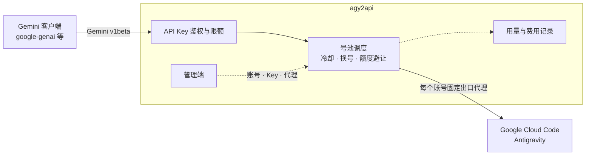

<p align="center">
  <picture>
    <source media="(prefers-color-scheme: dark)" srcset="docs/assets/logo-dark.svg">
    
  </picture>
</p>

<h1 align="center">agy2api</h1>

<p align="center"><strong>把 Antigravity 账号池变成可调度、可观测的 Gemini 兼容 API 网关</strong></p>

<p align="center">
  <a href="LICENSE"></a>
  
  
  
  
  
</p>

<p align="center"><a href="https://agy2api.pages.dev"><strong>在线演示</strong></a>（口令 <code>demo</code>，数据是模拟的）</p>

<p align="center">简体中文 | <a href="README_EN.md">English</a></p>

管理多个 Antigravity 账号，负责选号、冷却恢复、失败换号和额度避让，对外提供 Gemini 原生 `v1beta` 接口，自带管理端。

> **风险提示**：本项目经 Antigravity 账号访问 Google Cloud Code 的内部接口，这种用法可能违反 Google 的服务条款，
> 账号可能被限制或封禁，已付费的订阅不会因此退款。仅供学习和技术研究，风险自负。

## 功能

- **Gemini 原生接口**：`generateContent`、`streamGenerateContent`、`countTokens` 和模型列表，可直接用 `google-genai` 等 SDK
- **号池调度**：按账号和模型冷却，失败自动换号，额度低的账号避让，同一对话优先用同一账号，每个账号有并发上限
- **账号管理**：Google 登录添加或批量导入，令牌自动刷新，失效自动停用，可单独检测
- **出口代理**：每个账号绑定固定的出口代理（http、https、socks5）
- **API Key**：到期时间、Token 上限、允许的模型
- **用量和费用**：每次调用的明细，按官方 API 价格估算费用
- **管理端**：桌面和手机都能用，支持浅色和深色；管理口令防爆破、IP 白名单

## 架构



## 快速开始

一键安装（Linux，装成 systemd 服务，自动生成管理口令；再运行一次就是升级）：

```bash
curl -fsSL https://github.com/shiceai/agy2api/releases/latest/download/install.sh | sudo bash
```

用 Docker（镜像支持 linux/amd64、linux/arm64），在一个空目录里：

```bash
curl -fsSL https://github.com/shiceai/agy2api/releases/latest/download/install.sh | bash -s -- --docker
```

脚本会下载并校验 SHA256，想先看内容可以下载下来再运行；`--help` 查看全部选项（指定版本、监听地址、卸载等）。
也可以从 [Releases](https://github.com/shiceai/agy2api/releases) 手动下载对应平台的压缩包，解压后运行
`AGY2API_ADMIN_PASSWORD=<你的口令> ./agy2api`。

打开 `http://127.0.0.1:8080`，用管理口令登录，在"账号"页添加账号，在"密钥"页新建 API Key，然后调用：

```bash
curl http://127.0.0.1:8080/v1beta/models/gemini-2.5-flash:generateContent \
  -H "x-goog-api-key: agy-xxxxx" \
  -H "Content-Type: application/json" \
  -d '{"contents":[{"role":"user","parts":[{"text":"你好"}]}]}'
```

上公网前请看[部署说明](docs/deploy.md)：HTTPS 反向代理、管理端访问限制、备份和升级，以及 systemd 部署方式。

## 配置

常用的环境变量如下，写在 `.env` 里；完整列表见[部署说明](docs/deploy.md#环境变量)。

| 变量 | 说明 | 默认 |
| --- | --- | --- |
| `AGY2API_ADMIN_PASSWORD` | 管理口令，必填 | — |
| `AGY2API_ADDR` | 监听地址 | `:8080` |
| `AGY2API_DATA_DIR` | 数据目录（数据库和加密密钥） | `./data` |
| `AGY2API_ADMIN_ALLOW` | 只允许这些 IP 访问管理端（IP 或 CIDR，逗号分隔） | 不限 |
| `AGY2API_TRUSTED_PROXIES` | 可信的反向代理，只认它们转发来的客户端 IP | 回环和内网地址 |
| `AGY2API_LOG_LEVEL` | 日志级别：`debug`、`info`、`warn`、`error` | `info` |

## 从源码构建

```bash
cd web && pnpm install && pnpm build && cd ..
CGO_ENABLED=0 go build -o bin/agy2api .
```

也可以用 `./scripts/build.sh`，它会一起构建前端、注入版本号，并支持交叉编译（如 `./scripts/build.sh linux/amd64`）。

## 开发

```bash
# 用内置的模拟上游，不需要真实账号；跳过管理端鉴权
AGY2API_EMBED_MOCK=true AGY2API_ALLOW_NO_ADMIN_AUTH=true AGY2API_DATA_DIR=./data_dev go run .

cd web && pnpm dev       # 前端热更新，/api 和 /v1beta 转到 :8080
bash scripts/check.sh    # 提交前检查
```

开发约定见 [AGENTS.md](AGENTS.md)。

## 许可证

[MIT](LICENSE)
