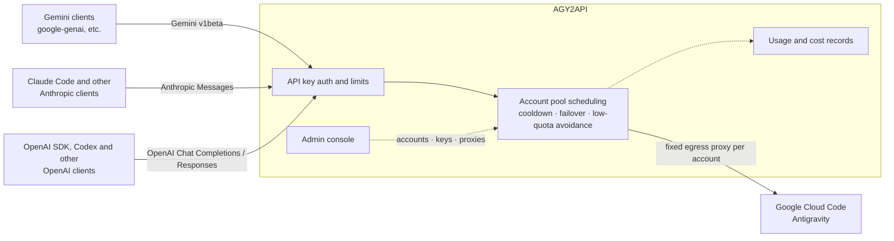

<p align="center">
  <picture>
    <source media="(prefers-color-scheme: dark)" srcset="docs/assets/logo-dark.svg">
    
  </picture>
</p>

<h1 align="center">AGY2API</h1>

<p align="center"><strong>Turn a pool of Antigravity accounts into a schedulable, observable API gateway that speaks the Gemini, Anthropic and OpenAI APIs</strong></p>

<p align="center">
  <a href="https://github.com/shiceai/agy2api/releases/latest"></a>
  <a href="https://github.com/shiceai/agy2api/actions/workflows/ci.yml"></a>
  <a href="LICENSE"></a>
  
  
  <a href="https://github.com/shiceai/agy2api/pkgs/container/agy2api"></a>
  
</p>

<p align="center"><a href="https://agy2api.pages.dev"><strong>Live demo</strong></a> (password <code>demo</code>, simulated data)</p>

<p align="center"><a href="README.md">简体中文</a> | English</p>

AGY2API manages multiple Antigravity accounts, handling account selection, cooldown recovery, failover and low-quota
avoidance. It exposes the native Gemini `v1beta` API, the Anthropic Messages API, and the OpenAI Chat Completions and Responses
APIs (Claude Code, Codex, the OpenAI SDK and others connect directly), and comes with an admin console.

> **Risk notice**: this project reaches Google Cloud Code's internal API through Antigravity accounts. This kind of use
> may violate Google's Terms of Service; accounts may be restricted or banned, and paid subscriptions will not be
> refunded. For learning and technical research only. Use at your own risk.

## Features

- **Native Gemini API**: `generateContent`, `streamGenerateContent`, `countTokens` and model listing; works with SDKs
  such as `google-genai`; the image model returns images as-is and supports multi-turn editing
- **Anthropic API**: `/v1/messages` (streaming and non-streaming) and `count_tokens`, so Claude Code and other Anthropic clients
  can connect directly; official model names are mapped to models in the pool by model aliases
- **OpenAI API**: `/v1/chat/completions` and `/v1/responses` (both with streaming) and model listing, with tool calls,
  images, thinking content and structured output; the OpenAI SDK, Cherry Studio, Codex and other clients can connect directly
- **Pool scheduling**: round-robin, scored (smart) or reset-first account selection, cooldowns per account and model,
  automatic failover, avoids accounts with low quota, keeps a conversation on the same account (recognizes Claude Code
  and Codex sessions and `X-Session-Id`; a short detour to another account keeps the binding), per-account
  concurrency limits
- **Account management**: add accounts with Google sign-in or bulk import, automatic token refresh, automatic disabling
  of revoked accounts, per-account testing; per-model quota display, with optional weekly quota
- **Lower the ban risk**: by default, requests carry the official client's base system prompt and declare a client version from a
  verified official build (kept current with official releases automatically, no gateway upgrade needed), so the upstream sees
  something closer to the official client; when it blocks Claude Code or Codex by
  their system prompt, the gateway moves the system into a user message automatically; optional new-account warmup (gradual
  ramp-up) and request pacing (spacing out a single account's requests); optional ban protection that pauses the whole pool
  for a while after an account is banned for terms of service violations
- **Egress proxies**: bind each account to a fixed egress proxy (http, https, socks5)
- **API keys**: expiry, token limits, allowed models
- **Usage and cost**: per-call details, cost estimated from official API prices; failed requests carry a request summary and
  the raw upstream error, and can optionally keep the request body for troubleshooting; conversations the upstream
  rejected are blocked locally afterwards
- **Alerts**: banned accounts, revoked refresh tokens, no available account, pool pauses and more go to a generic webhook,
  DingTalk, Feishu, WeCom or Telegram
- **Admin console**: works on desktop and mobile, light and dark themes; brute-force protection for the admin password,
  IP allowlist (the interface is in Chinese)
- **Online upgrade**: upgrade to a new release from the admin console in one click; Docker containers keep the new
  version after being recreated

## Architecture



## Quick start

One-line install (Linux, installs a systemd service and generates the admin password; run it again to upgrade). The
program, configuration and data all go into a new `agy2api` directory under the current directory; `--dir` picks another:

```bash
curl -fsSL https://github.com/shiceai/agy2api/releases/latest/download/install.sh | sudo bash
```

With Docker (images for linux/amd64 and linux/arm64), likewise in an `agy2api` directory under the current directory:

```bash
curl -fsSL https://github.com/shiceai/agy2api/releases/latest/download/install.sh | bash -s -- --docker
```

The script downloads and verifies SHA256 checksums; download it first if you want to read it. `--help` lists all options
(version, listen address, uninstall and more). You can also download the archive for your platform from
[Releases](https://github.com/shiceai/agy2api/releases), extract it and run `AGY2API_ADMIN_PASSWORD=<your password> ./agy2api`.

Open `http://127.0.0.1:8249`, sign in with the admin password, add accounts on the accounts page, create an API key on
the keys page, then call:

```bash
curl http://127.0.0.1:8249/v1beta/models/gemini-3-flash:generateContent \
  -H "x-goog-api-key: agy-xxxxx" \
  -H "Content-Type: application/json" \
  -d '{"contents":[{"role":"user","parts":[{"text":"Hello"}]}]}'
```

The model list (`/v1/models`) matches the official client: models with thinking tiers are listed once by family name (such as
`gemini-4-neon` or `claude-opus-5-5`), and the tier follows the request's thinking parameters (`reasoning_effort`,
`thinkingLevel` and so on), falling back to the default tier under Settings -> Thinking tiers. Tiered names (such as
`gemini-4-neon-high`) work as well.

Before exposing it to the internet, read the [deployment guide](docs/deploy.md) (in Chinese): HTTPS reverse proxy,
admin access control, backup and upgrade, uninstalling, and manual deployment. The conversion rules and limits of each
API are in the [API notes](docs/api.md) (in Chinese).

## Use with Claude Code

Create an API key on the keys page of the admin console, then:

```bash
export ANTHROPIC_BASE_URL=http://127.0.0.1:8249
export ANTHROPIC_AUTH_TOKEN=agy-xxxxx
claude
```

- Official model names sent by Claude Code (such as `claude-sonnet-5-5`, with or without a date or `[1m]`) are mapped to models
  in the pool by model aliases; Haiku, used for background tasks, maps to `claude-sonnet-5-5-low` by default and can be
  changed under Settings → Model aliases in the admin console.
- Other models in the pool work too, including Gemini, e.g. `claude --model gemini-3-flash`.
- Claude on Antigravity does not return its thinking, so Claude Code shows no thinking content; Anthropic server tools
  (such as WebSearch) are not supported.
- **Client compatibility (on by default)**: the upstream flags client fingerprints such as those of Claude Code and Codex
  in the system prompt and returns a 429 that looks like quota exhaustion. The gateway moves the client's system into a leading
  user message (only the system prompt is inspected, not the conversation), which gets the request through; the cost is
  that the client's system drops from system to user level and may slightly change how the model follows it. Turn it off
  under Settings -> Model aliases -> Client compatibility.

## Use with Codex

Create an API key on the Keys page of the admin console, put it in the `AGY2API_KEY` environment variable, and add a
provider to `~/.codex/config.toml`:

```toml
model = "gemini-3-flash"
model_provider = "agy2api"

[model_providers.agy2api]
name = "AGY2API"
base_url = "http://127.0.0.1:8249/v1"
env_key = "AGY2API_KEY"
wire_api = "responses"
```

- Use models from the pool, or switch for one run, e.g. `codex -m claude-sonnet-5-5-medium`. Codex does not know these
  model names and prints "Model metadata ... not found" at startup; this does no harm.
- A Codex session stays on the same account where possible (the conversation is recognized by its session ID).
- The upstream blocks Codex's system prompt too; the client compatibility above covers Codex as well.
- Codex's built-in web search (`web_search`) has no upstream counterpart and is dropped.

## Use with OpenAI-compatible clients

Set the base URL to `http://127.0.0.1:8249/v1` and the API key to a key created in the admin console, and use models
from the pool (`/v1/models` lists them):

```python
from openai import OpenAI

client = OpenAI(base_url="http://127.0.0.1:8249/v1", api_key="agy-xxxxx")
resp = client.chat.completions.create(
    model="gemini-3-flash",
    messages=[{"role": "user", "content": "Hello"}],
)
print(resp.choices[0].message.content)
```

- Supports streaming (including `stream_options.include_usage`), tool calls, images (data URLs; http URLs need remote
  image inlining turned on under Settings -> Request handling) and `reasoning_effort`. When a client uses model names
  that are not in the pool, map them with rules under Settings -> Model aliases.
- Thinking content is returned in the `reasoning_content` field (not part of the OpenAI standard; Cherry Studio and other
  clients display it). Turn it off under Settings -> Request handling.
- `response_format` with `json_schema` works with Gemini models; `json_object` is not enforced by the upstream and relies
  on the prompt; Claude models do not support structured output (the upstream returns 400).
- The Responses API (`/v1/responses`) does not store responses: send the whole conversation every turn;
  `previous_response_id` and `background` are not supported (400). Thinking goes into the summary of reasoning items;
  when `include` asks for `reasoning.encrypted_content`, the thought signature comes with it, so just send the items back
  in the next turn.
- Not supported: `n` greater than 1, and files uploaded through the Files API (`file_id`).

## Upgrade

- **Online upgrade**: when a new release is available, the version under the name in the admin console's sidebar turns
  green with an up arrow; click it to read the release notes and upgrade in one click. The server verifies the package,
  backs up the database and restarts in place, with a few seconds of downtime. The new binary lives in the data
  directory, so it survives recreating the Docker container or restarting the systemd service; if it fails to start,
  the previous version takes over again, and you can also undo the upgrade. Linux and macOS are supported; set
  `AGY2API_UPDATE=off` to turn it off.
- **Manual upgrade**: run the install script above again (add `--docker` for Docker); with your own compose file, run
  `docker compose pull && docker compose up -d`.

See the [deployment guide](docs/deploy.md#在线升级) for details.

## Configuration

Common environment variables, set in `.env`; see the [deployment guide](docs/deploy.md#环境变量) for the full list.

| Variable | Description | Default |
| --- | --- | --- |
| `AGY2API_ADMIN_PASSWORD` | Admin password, required | — |
| `AGY2API_ADDR` | Listen address; separate several with commas (such as localhost plus a WireGuard address) | `:8249` |
| `AGY2API_DATA_DIR` | Data directory (database and encryption key) | `./data` |
| `AGY2API_ADMIN_ALLOW` | Only these IPs may access the admin console (IPs or CIDRs, comma-separated) | No restriction |
| `AGY2API_TRUSTED_PROXIES` | Trusted reverse proxies; the client IP is taken only from what they forward | Loopback and private addresses |
| `AGY2API_LOG_LEVEL` | Log level: `debug`, `info`, `warn`, `error` | `info` |
| `AGY2API_UPDATE` | Online upgrade: check for new releases daily and when the admin UI is opened; `off` turns it off (no calls to GitHub) | On |

## Build from source

```bash
cd web && pnpm install && pnpm build && cd ..
CGO_ENABLED=0 go build -o bin/agy2api .
```

Or use `./scripts/build.sh`, which also builds the frontend, injects the version and supports cross-compiling (such as
`./scripts/build.sh linux/amd64`).

## Development

```bash
# Use the built-in mock upstream (no real account needed) and skip admin auth
AGY2API_EMBED_MOCK=true AGY2API_ALLOW_NO_ADMIN_AUTH=true AGY2API_DATA_DIR=./data_dev go run .

cd web && pnpm dev       # frontend with hot reload; /api and /v1beta go to :8249
bash scripts/check.sh    # pre-commit checks
```

Development conventions are in [AGENTS.md](AGENTS.md) (in Chinese).

## License

[MIT](LICENSE)
