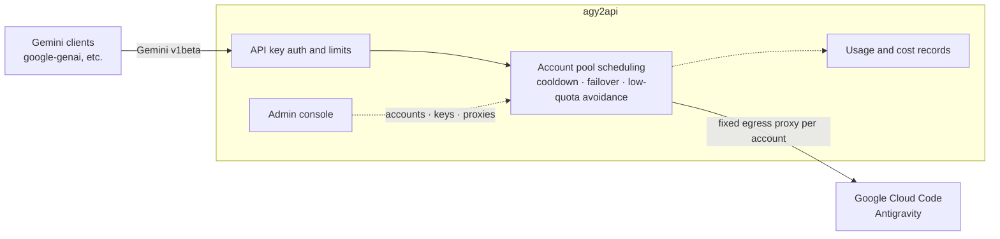

<p align="center">
  <picture>
    <source media="(prefers-color-scheme: dark)" srcset="docs/assets/logo-dark.svg">
    
  </picture>
</p>

<h1 align="center">agy2api</h1>

<p align="center"><strong>Turn a pool of Antigravity accounts into a schedulable, observable Gemini-compatible API gateway</strong></p>

<p align="center">
  <a href="LICENSE"></a>
  
  
  
  
  
</p>

<p align="center"><a href="https://agy2api.pages.dev"><strong>Live demo</strong></a> (password <code>demo</code>, simulated data)</p>

<p align="center"><a href="README.md">简体中文</a> | English</p>

agy2api manages multiple Antigravity accounts, handling account selection, cooldown recovery, failover and low-quota
avoidance. It exposes the native Gemini `v1beta` API and comes with an admin console.

> **Risk notice**: this project reaches Google Cloud Code's internal API through Antigravity accounts. This kind of use
> may violate Google's Terms of Service; accounts may be restricted or banned, and paid subscriptions will not be
> refunded. For learning and technical research only. Use at your own risk.

## Features

- **Native Gemini API**: `generateContent`, `streamGenerateContent`, `countTokens` and model listing; works with SDKs
  such as `google-genai`
- **Pool scheduling**: cooldowns per account and model, automatic failover, avoids accounts with low quota, keeps a
  conversation on the same account, per-account concurrency limits
- **Account management**: add accounts with Google sign-in or bulk import, automatic token refresh, automatic disabling
  of revoked accounts, per-account testing
- **Egress proxies**: bind each account to a fixed egress proxy (http, https, socks5)
- **API keys**: expiry, token limits, allowed models
- **Usage and cost**: per-call details, cost estimated from official API prices
- **Admin console**: works on desktop and mobile, light and dark themes; brute-force protection for the admin password,
  IP allowlist (the interface is in Chinese)
- **Online upgrade**: upgrade to a new release from the admin console in one click; Docker containers keep the new
  version after being recreated

## Architecture



## Quick start

One-line install (Linux, installs a systemd service and generates the admin password; run it again to upgrade):

```bash
curl -fsSL https://github.com/shiceai/agy2api/releases/latest/download/install.sh | sudo bash
```

With Docker (images for linux/amd64 and linux/arm64), in an empty directory:

```bash
curl -fsSL https://github.com/shiceai/agy2api/releases/latest/download/install.sh | bash -s -- --docker
```

The script downloads and verifies SHA256 checksums; download it first if you want to read it. `--help` lists all options
(version, listen address, uninstall and more). You can also download the archive for your platform from
[Releases](https://github.com/shiceai/agy2api/releases), extract it and run `AGY2API_ADMIN_PASSWORD=<your password> ./agy2api`.

Open `http://127.0.0.1:8080`, sign in with the admin password, add accounts on the accounts page, create an API key on
the keys page, then call:

```bash
curl http://127.0.0.1:8080/v1beta/models/gemini-2.5-flash:generateContent \
  -H "x-goog-api-key: agy-xxxxx" \
  -H "Content-Type: application/json" \
  -d '{"contents":[{"role":"user","parts":[{"text":"Hello"}]}]}'
```

Before exposing it to the internet, read the [deployment guide](docs/deploy.md) (in Chinese): HTTPS reverse proxy,
admin access control, backup and upgrade, and deployment with systemd.

## Configuration

Common environment variables, set in `.env`; see the [deployment guide](docs/deploy.md#环境变量) for the full list.

| Variable | Description | Default |
| --- | --- | --- |
| `AGY2API_ADMIN_PASSWORD` | Admin password, required | — |
| `AGY2API_ADDR` | Listen address | `:8080` |
| `AGY2API_DATA_DIR` | Data directory (database and encryption key) | `./data` |
| `AGY2API_ADMIN_ALLOW` | Only these IPs may access the admin console (IPs or CIDRs, comma-separated) | No restriction |
| `AGY2API_TRUSTED_PROXIES` | Trusted reverse proxies; the client IP is taken only from what they forward | Loopback and private addresses |
| `AGY2API_LOG_LEVEL` | Log level: `debug`, `info`, `warn`, `error` | `info` |

## Build from source

```bash
cd web && pnpm install && pnpm build && cd ..
CGO_ENABLED=0 go build -o bin/agy2api .
```

Or use `./scripts/build.sh`, which also builds the frontend, injects the version and supports cross-compiling (such as
`./scripts/build.sh linux/amd64`).

## Development

```bash
# Use the built-in mock upstream (no real account needed) and skip admin auth
AGY2API_EMBED_MOCK=true AGY2API_ALLOW_NO_ADMIN_AUTH=true AGY2API_DATA_DIR=./data_dev go run .

cd web && pnpm dev       # frontend with hot reload; /api and /v1beta go to :8080
bash scripts/check.sh    # pre-commit checks
```

Development conventions are in [AGENTS.md](AGENTS.md) (in Chinese).

## License

[MIT](LICENSE)
